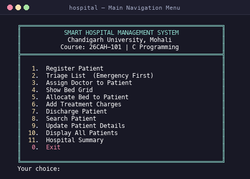
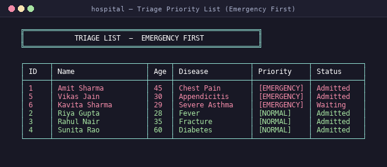
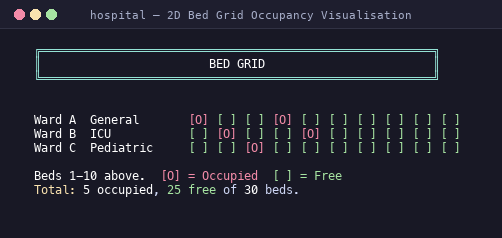
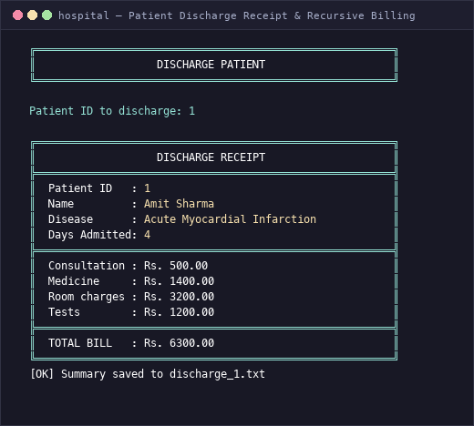
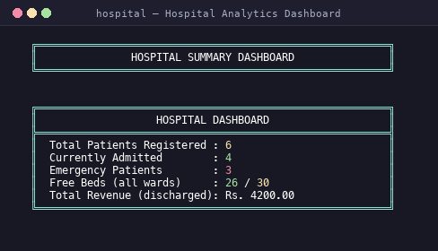
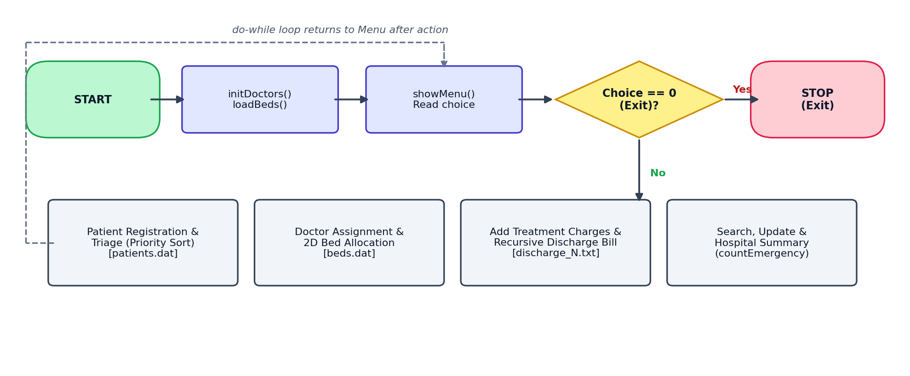

# 🏥 Smart Hospital Management System with Emergency Triage

> **Course:** Computer Programming (26CAH-101) | **Institution:** Chandigarh University, Mohali, Punjab  
> **Author:** Palash Behura | **Language:** C (Standard C99)

A comprehensive, console-based clinical workflow and emergency triage system built strictly within foundational C programming syllabus boundaries. Features include priority-based emergency triage queueing, 2D matrix bed allocation across hospital wards, doctor workload caps, in-place binary file persistence, recursive billing, and ANSI-colored interactive terminal rendering with pixel-perfect box alignment.

---

## 📸 System Previews

<div align="center">
  
  
</div>

<div align="center">
  
  
</div>

<div align="center">
  
</div>

---

## 🏛️ System Architecture & Workflow

The system follows a modular architectural pipeline connecting emergency patient intake to triage, bed allotment, clinical care, and recursive billing:

<div align="center">
  
</div>

---

## 📋 Key Features & C Implementation Mapping

| Module | Feature Description | Core C Syllabus Concepts |
|---|---|---|
| **1. Patient Registration** | Ingests emergency/routine patients with input validation, assigning sequential auto-incremented IDs. | `struct Patient`, `fgets`, `scanf`, `fwrite` (binary append) |
| **2. Triage Prioritization** | Sorts waiting queue placing critical emergency cases first, preserving arrival FIFO order. | Dynamic `malloc`, pointer arithmetic `*(arr + i)`, bubble sort |
| **3. Doctor Assignment** | Assigns specialized physicians across departments; enforces a hard 5-patient workload limit. | `struct Doctor[]`, in-place binary file update via `fseek` |
| **4. Bed Occupancy Grid** | Renders 3 Wards (General, ICU, Pediatric) × 10 Beds in a 2D occupancy matrix (`[O]` occupied, `[ ]` free). | 2D arrays, pointer-to-array `int (*grid)[10]` parameter passing |
| **5. Bed Allocation** | Automated discovery of first available bed in selected ward with immediate state persistence. | `fread`/`fwrite`, pointer dereferencing, multi-file synchronization |
| **6. Treatment Charges** | Records itemized medical expenses (consultation, pharmacy, daily room rate, diagnostics). | Nested structures (`struct Charges`), record updating |
| **7. Discharge & Billing** | Frees bed, writes itemized text summary (`discharge_<ID>.txt`), and calculates bill. | **Recursion** (`totalBill`), `fprintf`, file pointer manipulation |
| **8. Patient Search** | Substring and exact-match search by patient ID or full name. | `strstr`, `strcmp`, dynamic allocation with `calloc` |
| **9. Record Updating** | In-place modification of clinical diagnoses and admission status. | Binary random access file updates using `fseek(SEEK_SET)` |
| **10. Registry Table** | Formatted tabular display of all active, admitted, and discharged patient records. | Record traversal with `fread`, formatted `printf` width specifiers |
| **11. Analytics Dashboard** | Real-time census: admitted counts, bed availability ratio, and total hospital revenue. | **Recursive counting** (`countEmergency`), arithmetic aggregation |
| **99. Demo Data Ingestion** | Seeds 30 realistic clinical cases (15 admitted, 10 waiting, 5 discharged) with safety confirmation prompt. | Batch binary serialization & safe state reset |

---

## 🎯 Syllabus Compliance (26CAH-101)

This project strictly adheres to the foundational C curriculum of Chandigarh University:
- **Language Standard:** C99 compiled with `-Wall -Wextra -Wpedantic`.
- **Allowed Standard Libraries:** `<stdio.h>`, `<stdlib.h>`, `<string.h>`, `<ctype.h>`.
- **Prohibited Constructs Respected:** Zero `typedef`, zero `union`, zero `enum`, no linked lists or node structures, no function pointers, no external database dependencies, and no platform-dependent GUI libraries.
- **Advanced Core C Techniques:**
  - **Recursion:** `totalBill(float charges[], int n)` sums itemized hospital expenses recursively; `countEmergency(struct Patient *arr, int n)` counts critical patients without iterative loops.
  - **Pointers & Pointer Arithmetic:** Pointer-to-array parameter passing `int (*grid)[BEDS_PER_WARD]`, array indexing via pointer offset `*(arr + j)`, and direct structure pointer manipulation `struct Patient *p`.
  - **Binary File Handling:** Robust binary persistence via `patients.dat` and `beds.dat` utilizing `fopen`, `fread`, `fwrite`, `fseek`, and `fclose`.

---

## 📂 Project Organization

```text
smart-hospital-management-system/
├── main.c                          # Complete single-file C99 implementation
├── README.md                       # Comprehensive project documentation
├── .gitignore                      # Git exclusion rules for binaries, data & cache
├── docs/                           # University submission deliverables
│   ├── Smart_Hospital_Management_System_Report.pdf       # 12-page academic project report
│   ├── Smart_Hospital_Management_System_Report.docx      # Editable Word manuscript
│   └── Smart_Hospital_Management_System_Presentation.pptx # 10-slide seminar presentation
├── assets/                         # Diagrams and visual media
│   ├── flowchart.png               # High-resolution architectural flowchart
│   └── screenshots/                # Terminal screenshots captured during execution
│       ├── menu.png                # Boxed main navigation menu
│       ├── register.png            # Patient intake interface
│       ├── triage.png              # Priority-sorted triage queue
│       ├── bed_grid.png            # 2D ward-bed allocation matrix
│       ├── discharge.png           # Formatted discharge receipt
│       └── summary.png             # Hospital analytics summary
└── tests/                          # Automated quality assurance suite
    └── smoke_test.py               # Sandboxed C99 compiler & runtime test
```

---

## 🛠️ Build and Execution Guide

### Prerequisites
- GCC / Clang C compiler supporting C99 standard
- Any standard POSIX terminal (macOS Terminal, Linux Bash/Zsh, or VS Code integrated terminal)

### Compilation
Compile with strict error and style warnings enabled:
```bash
gcc -std=c99 -Wall -Wextra -Wpedantic main.c -o hospital
```

### Running the System
```bash
./hospital
```

### Quick Demonstration (30-Patient Seeded Dataset)
1. **Load Demo Dataset:** When the main menu loads, type `99` and hit **Enter**.
   - *Safety Prompt:* The system displays a warning that existing records will be reset. Confirm by entering `y`. (Entering `n` cancels safely with zero data alteration).
   - *Dataset Loaded:* 30 patients seeded (15 Admitted, 10 Waiting, 5 Discharged).
2. **Priority Triage:** Select `2` to view the **Triage List** sorted emergency-first.
3. **Doctor Capacity Enforcement:** Select `3` to assign a doctor:
   - Notice **Dr. Rohit Mehta (General Medicine)** is at full capacity (**5/5**). Attempting to assign waiting patient `17` to Doctor `2` will be rejected.
   - Assigning patient `17` to **Dr. Priya Sharma (Emergency)** (**4/5**) will succeed.
4. **2D Bed Matrix:** Select `4` to view the **Bed Grid** (15 occupied, 15 free — exactly 5 free in General, 5 in ICU, 5 in Pediatric).
5. **Bed Allocation:** Select `5`, enter waiting patient `18`, choose Ward `1` (General). The first free bed (Ward 1, Bed 6) is allocated immediately.
6. **Discharge & Recursive Billing:** Select `7`, enter admitted patient `1` to discharge. A boxed receipt is generated with the total calculated recursively, the bed is freed, and a summary is saved to `discharge_1.txt`.
7. **Hospital Analytics:** Select `11` to inspect the **Hospital Summary Dashboard** reflecting real-time active admissions, emergency ratios, available beds, and discharged revenue.

---

## 🧪 Automated Testing Suite

The repository includes a fully automated smoke test suite located in `tests/smoke_test.py`. It:
- Compiles `main.c` with `-std=c99 -Wall -Wextra -Wpedantic` and verifies zero warnings.
- Spawns an isolated `tempfile.TemporaryDirectory()` sandbox.
- Tests the entire lifecycle: demo injection, registration, triage, doctor assignment, bed allocation, treatment fees, discharge calculation, search, dashboard, and clean exit.
- Verifies that zero temporary data files leak into the source repository.

To execute the test:
```bash
python3 tests/smoke_test.py
```

---

## 👨‍💻 Academic Details

| Parameter | Information |
|---|---|
| **Student Name** | Palash Behura |
| **Course** | Computer Programming (26CAH-101) |
| **Degree Program** | Bachelor of Computer Applications (BCA) |
| **Institution** | Chandigarh University, Mohali, Punjab |
| **Repository** | [smart-hospital-management-system](https://github.com/palashbehura54-source/smart-hospital-management-system) |
| **Academic Session** | 2026 – 2027 |
